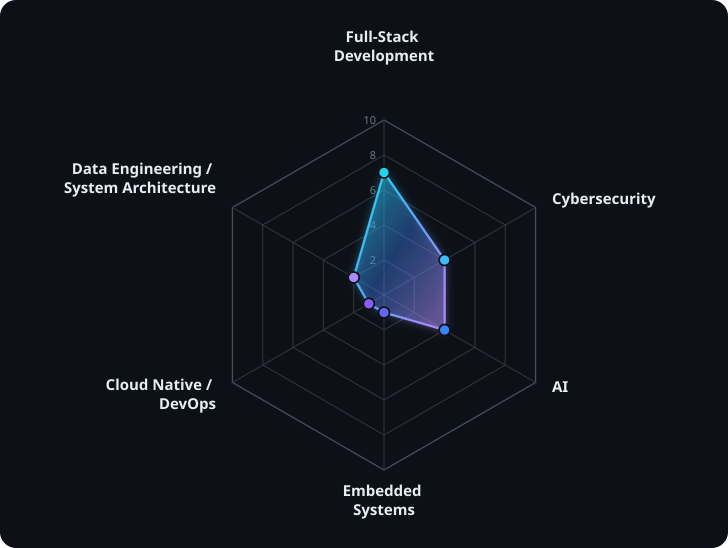

## Hi there 👋

<!--
**zol9527/zol9527** is a ✨ _special_ ✨ repository because its `README.md` (this file) appears on your GitHub profile.

Here are some ideas to get you started:

- 🔭 I’m currently working on ...
- 🌱 I’m currently learning ...
- 👯 I’m looking to collaborate on ...
- 🤔 I’m looking for help with ...
- 💬 Ask me about ...
- 📫 How to reach me: ...
- 😄 Pronouns: ...
- ⚡ Fun fact: ...
-->

  <table>
    <tr>
      <td>
        <pre> ______    ____    __       ___     ____     ____     _____ 
/__  /    / __ \  / /      / _ \   / ___|   |___ \   |___  |
  / /    / / / /  / /     | (_) |  \___ \    ___) |     / / 
 / /___  / /_/ /  / /___   \__, |   ___) |  / __/      / /  
/_____/  \____/   /____/     /_/   |____/   |____|    /_/   </pre>
      </td>
    </tr>
  </table>
  <h1>zol9527</h1>
  
本来很喜欢 Full Stack，想着把自己的想法一个个做出来，没想到一路折腾，入了国军 Cyber Security。

  

 

  

